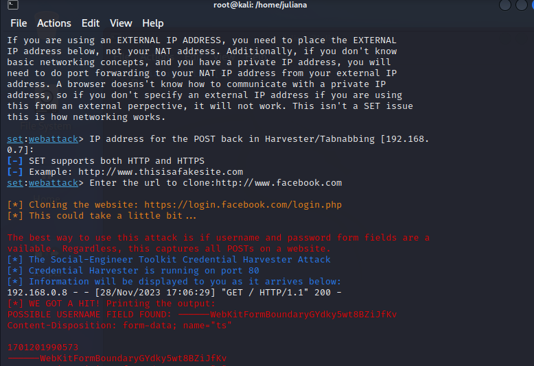

# 🎣 Laboratório Educacional de Phishing

Laboratório realizado em ambiente controlado, em rede local, para estudar como funciona um ataque de phishing e, principalmente, como identificá-lo e preveni-lo.

## 🎯 Objetivo

Compreender, de forma prática, como uma página falsa é estruturada e quais sinais permitem reconhecê-la.

## 🧰 Ambiente

- Kali Linux
- SEToolkit
- Rede local de laboratório, isolada

## 📚 Conteúdos estudados

- Engenharia social
- Clonagem de página de login
- Coleta de credenciais em ambiente controlado

## 🖼️ Resultado

*Captura do laboratório: a página clonada sendo servida na rede local e o registro do envio do formulário.*

## 🔎 O que observei

- A página clonada era servida por HTTP (porta 80), a partir do IP da máquina do laboratório, e não pelo domínio real
- O endereço no navegador era diferente do site original
- Os dados do formulário iam direto para a máquina do laboratório
- Visualmente a página parecia igual à original, então só olhar o visual não basta

## 🛡️ Como identificar um phishing

- Conferir o **endereço (domínio)** antes de digitar qualquer dado
- Desconfiar de mensagens com urgência, ameaça ou prêmio
- Verificar o remetente e erros de escrita
- Lembrar que o cadeado (HTTPS) não garante que o site é legítimo
- Analisar o cabeçalho do e-mail (SPF, DKIM e DMARC)

## 🧱 Como prevenir

- Ativar **autenticação em dois fatores (MFA)**
- Usar gerenciador de senhas, que só preenche no domínio correto
- Filtros de e-mail e bloqueio de domínios maliciosos (DNS e proxy)
- Treinamento de conscientização
- Reportar mensagens suspeitas ao time de segurança

## 🔔 Na visão de um SOC

Esse tipo de ataque costuma ser investigado a partir de e-mails reportados, acessos a domínios parecidos com a marca nos logs de DNS e proxy, e envio de credenciais para destinos externos.

## ⚠️ Aviso

Este projeto foi realizado exclusivamente para fins educacionais, em ambiente controlado. O objetivo é compreender a técnica para aprendizado em Segurança da Informação, e não realizar ataques contra terceiros.
## Resultado 

